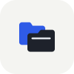

# TwinFile

**开源、免费的 Android 双栏文件管理器**

统一管理本地存储、网络共享、电脑文件与已授权云盘。

  
  
  
  
  
  
  

双栏独立导航，支持跨来源文件操作；所有功能免费开放。

| 双栏浏览 | 压缩与加密 |
|:---:|:---:|
|  |  |
| 独立导航，在两个位置之间复制与移动 | 常用压缩格式，以及带密码的压缩包 |

## 功能

- **双栏与单栏浏览**：两栏独立导航、面包屑、前进后退、自然排序、过滤和隐藏文件。
- **选择与文件操作**：滑动选择、拖动连续选择、复制、移动、重命名、新建、同名冲突处理、回收站和校验值计算；耗时任务显示进度并可取消。
- **压缩与解压**：ZIP、7z、TAR、TAR.GZ/TGZ；ZIP 支持 AES-256 加密压缩，解压支持 ZipCrypto/AES ZIP 和带密码的 7z。ZIP 可直接进入浏览；智能解压避免重复嵌套和文件散落。详见[格式支持与密码说明](docs/archives.md)。
- **查看与打开**：图片缩放和切换、UTF-8/GBK 文本、Markdown 预览，以及可记住默认应用的“打开方式”。
- **网络位置**：FTP、FTPS、SFTP、SMB 2/3、WebDAV；可在本地与网络位置间复制。密码用 Android Keystore 加密保存，SFTP 首次连接确认主机指纹。
- **云盘**：Google Drive 和 OneDrive 原生授权客户端，接入双栏文件操作；Google Drive 已配置登录入口，OneDrive 待完成应用注册后启用。见[接入与配置](docs/cloud-drives.md)。
- **管理电脑文件**：配合 [SyncBoard](https://github.com/copylee711/syncboard)，扫码或局域网配对后直接浏览电脑磁盘、复制、移动和删除文件。
- **最近文件**：在当前栏聚合本地最近新增/修改的文件，支持最近打开记录和定位所在位置；目录返回可恢复滚动位置，也可固定顶部上级入口。
- **应用与收藏**：已安装应用信息、APK 提取、分包导出、书签和最近访问；侧栏快捷图标支持长按自定义目录。
- **外观**：7 种主题色、Android 壁纸取色、浅色/深色、紧凑列表及可关闭的目录动画。

## 开始使用

安装 Release 中的 APK，按提示授予文件访问权限即可管理本地文件。通过“网络位置”添加远程服务器；SMB 必须填写共享路径，例如 `/Public` 或 `/Public/文档`，暂不支持自动发现共享名。

访问 Android/data、Android/obb 或系统目录，以及连接 SyncBoard 电脑的方法，见[高级访问与电脑配对](docs/advanced-access.md)。

## 文档

- [压缩格式、加密与兼容性](docs/archives.md)
- [网络位置与 SMB 配置](docs/network.md)
- [高级访问与电脑配对](docs/advanced-access.md)
- [权限、隐私与自动更新](docs/permissions.md)
- [构建、测试、签名与发版](docs/development.md)
- [性能与依赖](docs/dependencies.md)
- [Google Drive / OneDrive 接入与配置](docs/cloud-drives.md)

后续计划：RAR 解压、文件搜索、目录大小分析和批量重命名。
