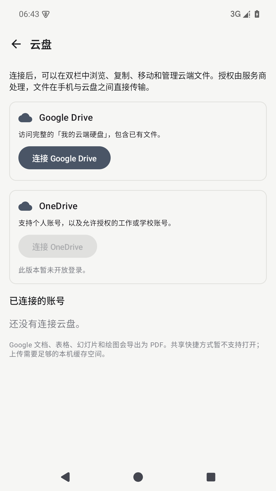

# Google Drive 与 OneDrive

TwinFile 已实现两种云盘的原生授权与文件管理客户端。文件在本机与云盘之间直接传输，不经过 TwinFile 自有服务器。

Google Android OAuth 客户端已按维护者提供的配置接入，并启用 Google Drive 入口。维护者已确认包名、release 签名指纹、Drive API 和测试用户配置。OneDrive 的应用尚未注册，入口在填写公开 client ID 后启用。

**当前验证范围**：已完成模拟 API、文件操作契约、分块上传、令牌重试和下载凭据隔离测试。签名版已在模拟器启动 Google 原生账号授权并验证取消返回；真实 Google/Microsoft 账号授权、撤权与文件往返仍需账号联调，不以模拟服务测试替代。



## 可以做什么

| 操作 | Google Drive | OneDrive |
|---|---|---|
| 账号 | Google 账号 | 个人账号、允许用户授权的工作/学校账号 |
| 浏览范围 | 我的云端硬盘 | 当前账号的默认 OneDrive |
| 文件操作 | 下载、上传、新建、重命名、移动、移入回收站 | 同左 |
| 双栏传输 | 本地、网络位置和云盘间复制；跨来源移动使用复制后删除 | 同左 |
| 多账号 | 支持，来源与缓存按账号隔离 | 支持 |
| 重名文件 | 按 ID 区分，操作不依赖显示名称 | 按 ID 引用 |
| 原生在线文档 | 文档、表格、幻灯片、绘图导出为 PDF，不直接修改其内容 | 普通 Office 文件按原文件下载 |

Google 共享云端硬盘、共享快捷方式、OneDrive 的跨 drive 共享快捷方式，以及 Microsoft 世纪互联/政府云暂未接入。快捷方式会保留在列表中，尝试打开时明确说明不支持，不会伪装成空目录。

列表会读取完整分页。授权失效、无权限、服务限流和不存在的文件均报告错误，不返回伪成功的空列表。Google Drive 同目录重名项使用各自的对象 ID；手动输入的路径遇到重名会要求从列表选择具体文件。

新文件名与已有对象引用分别编码；类似内部引用的文件名也会作为字面名称处理，不会改变上传、覆盖或删除的目标。

上传先写入本机临时文件，再使用有界分块发送：OneDrive 每块 5 MiB，Google Drive 每块 4 MiB。需要足够的本机缓存空间。取消或源读取失败不会提交残缺的缓存文件；上传失败会尝试终止会话。重试会重新上传，目前不支持跨应用重启的断点续传。进度包括本机暂存，达到暂存字节数后仍可能等待云端确认。

## Google Cloud 注册与配置

当前公开的 Android client ID：

```text
308773623063-bce453o5cj7llcinhg7t45mlgbj1l9ep.apps.googleusercontent.com
```

此 ID 不是秘密。Google 原生授权服务根据 **包名和签名证书** 匹配 Android 客户端，不把 client secret 放进 APK，也不使用 Web 客户端的后端授权码流程。

1. 在 Google Cloud 项目中启用 Google Drive API。
2. 配置 OAuth 品牌、用户类型和数据访问，声明完整的 `https://www.googleapis.com/auth/drive` 权限。
3. 创建 Android 类型的 OAuth 客户端，包名填写 `app.twinfile`，绑定实际签名证书的 SHA-1。
4. 测试状态下添加测试账号。公开发行时按 Google 的受限权限审核流程提交；本机直接处理并不自动免除审核，安全评估要求以实际数据流和官方政策为准。
5. 使用正式签名 APK 验证首次同意、账号选择、授权过期、撤销授权与文件操作。debug APK 使用不同证书，需要单独注册其 SHA-1。

本项目正式签名信息：

```text
包名：app.twinfile
SHA-1：D9:A3:88:74:F1:16:61:9E:CA:45:D4:12:44:08:4D:BB:84:18:A5:E8
```

构建参数（公开配置已在项目 gradle.properties 中填写）：

```properties
twinfile.googleAndroidClientId=你的Android客户端ID
twinfile.googleDriveEnabled=true
```

`drive.file` 只能访问应用创建或用户明确选给应用的文件，不能用于全盘浏览。此项目已明确选择受限的 `drive` 权限。

## Microsoft Entra 注册与配置

1. 创建应用注册，支持个人 Microsoft 账号和组织目录账号。
2. 添加 Android 平台，包名填写 `app.twinfile`。正式签名的 Base64 散列如下；使用自有签名时必须重新计算。
3. 使用公共客户端，授权 API 添加 Microsoft Graph 委托权限 `Files.ReadWrite`。不创建、不分发 client secret。组织账号仍受租户管理员的同意策略约束。
4. 填写公开 client ID，构建并测试 MSAL 浏览器授权、静默续期与退出。

```text
签名散列：2aOIdPEWYZ7KRdQSRAhNu4QYpeg=
回调 URI：msauth://app.twinfile/2aOIdPEWYZ7KRdQSRAhNu4QYpeg%3D
```

本机构建可以在用户级 `~/.gradle/gradle.properties` 填写：

```properties
twinfile.microsoftClientId=你的公开应用client-ID
```

或使用环境变量 `TWINFILE_MICROSOFT_CLIENT_ID`。GitHub Release 构建读取同名 **Repository variable**，不需要将它保存为 secret。未配置时 OneDrive 按钮保持禁用，并说明此版本尚未开放登录。

## 账号与数据

- Google 使用 Google Identity Services；Microsoft 使用 MSAL 8.6。访问令牌仅在内存和平台/SDK 的凭据缓存中使用，不存入网络位置密码字段或普通 JSON。
- 账号元数据以 Android Keystore 加密后保存在应用私有目录；每个账号的上传、预览缓存分开存放。
- 下载跳转到预授权地址时不携带 bearer token；OneDrive 上传会话同样不附加 bearer token。只向配置的云盘 API 主机发送授权头。
- 移除账号会使旧来源引用失效，清理本机缓存，并尝试撤销或移除本应用的授权。离线时无法保证远程撤权完成，界面会提示到服务商的账号权限页面检查；不移除手机系统账号。
- 云端删除使用服务商回收站，保留期限和恢复方式由服务商决定。

## 代码与测试

- `cloud/CloudAuth.kt`：原生授权、续期、退出。
- `cloud/CloudManager.kt`：加密账号存储、来源和缓存生命周期。
- `cloud/CloudHttp.kt`：凭据隔离、错误映射、401 重试、限流处理。
- `cloud/DriveApis.kt`：Drive / Graph REST 文件操作、分页和上传会话。
- `cloud/CloudSource.kt`：以稳定对象 ID 适配 FileSource。
- `CloudSourceTest`、`CloudHttpTest`、`CloudUploadTest`：重名操作、跨来源传输、缓存失败清理、分页、认证重试、重定向隔离和分块协议验证。

## 官方资料

- [Drive 权限范围与审核](https://developers.google.com/workspace/drive/api/guides/api-specific-auth)
- [Android Google 原生授权](https://developer.android.com/identity/authorization)
- [Drive 上传协议](https://developers.google.com/workspace/drive/api/guides/manage-uploads)
- [Drive 下载与导出](https://developers.google.com/workspace/drive/api/guides/manage-downloads)
- [MSAL Android 配置](https://learn.microsoft.com/en-us/entra/msal/android/msal-configuration)
- [Graph 权限参考](https://learn.microsoft.com/en-us/graph/permissions-reference#filesreadwrite)
- [Graph 上传会话](https://learn.microsoft.com/en-us/graph/api/driveitem-createuploadsession?view=graph-rest-1.0)
